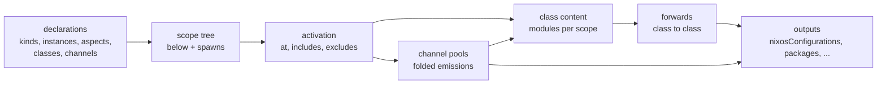

# Ren & Stimpy


> Usage examples: [Fleet Template](ren/templates/fleet/modules) - [vic/vix](https://github.com/vic/vix/tree/ren) - [adda/nix-config (forked by vic)](https://codeberg.org/vic/adda-config)

Ren is a small surface language for aspect-oriented, context-driven Nix fleets.
You declare your own domain (kinds and instances), and Ren puts each piece of configuration at the correct place in it.
[vic](https://github.com/vic) designed Ren and [Den](https://github.com/denful/den) inspired it: if you know Den, you know the ideas, and Ren gives them a smaller grammar.

This README is the design. The [fleet template](ren/templates/fleet) is its executable example.
The top part is a short tour. The [specification](#specification) and the reference parts are collapsed below it.

## example

One root kind, one host, one channel, one class and one aspect. The full fleet is the [template](ren/templates/fleet/modules).

```nix
{ ren, lib, inputs, ... }:
{
  ren.kinds.fleet.below = [ ren.kinds.host ]; # root kind: hosts are its children
  ren.kinds.host.addr = lib.types.str; # a typed field; no default = required
  ren.fleet.main = { };
  ren.host.lb.addr = "10.0.1.1"; # an instance; one scope: fleet:main/host:lb
  ren.channels.persist = {
    fold = ren.lib.fold.set; # a receiver gets the emissions as a set
    at = ren.kinds.host; # emitters: the host scopes
    to = e: e.host; # receiver: the host that emitted
  };
  ren.classes.nixos = {
    at = ren.kinds.host; # one nixos module system per host scope
    into = { host, ... }: ms: { # ms: the nixos modules that landed at this host
      nixosConfigurations.${host.name} = inputs.nixpkgs.lib.nixosSystem {
        system = "x86_64-linux";
        modules = ms;
      };
    };
  };
  ren.aspects.motd = {
    at = ren.kinds.host; # a predicate: the scopes where the aspect is active
    persist = { ... }: "/var/lib/motd"; # an emission into the persist channel
    nixos = { persist, ... }: { # the folded pool arrives as a content arg
      environment.etc.motd.text = "managed by ren";
      environment.etc.persisted.text = lib.concatStringsSep "\n" persist;
    };
  };
}
```

`host` in `into` is a binding: the scope binds each instance on its path under its kind name.
Here it is `ren.host.lb`. `ms` is the list of modules that the aspects landed at this scope.
The `persist` pool at lb is `[ "/var/lib/motd" ]`.

## what-ren-and-stimpy-are

One design, two twin implementations. They exist to measure Gen against `nixpkgs.lib`.
A difference between them must come from the library, never from the fleet.

- [Ren](ren) is built only on [Gen](https://github.com/sini/gen). The pinned rev is in [ren/default.nix](ren/default.nix).
  Ren is not the next Den. It checks that Gen can implement every [Den capability](#den-coverage).
  [ren/lib](ren/lib) does not use nixpkgs. The realized configs still go through `lib.nixosSystem` and friends.
- [Stimpy](stimpy) is built only on `nixpkgs.lib`. It never uses Gen code.
- Both run one fleet template. `ren/templates/fleet` and `stimpy/templates/fleet` are the same tree.
  Only `flake.nix` and `flake.lock` differ (the input `ren` or `stimpy`).
- Ren knows nothing about hosts, users or NixOS. You declare your own domain. Ren wires it together.
  All kind names in this README (`environment`, `host`, `mac`) belong to the template, not to Ren.

## concepts

Ren has few concepts. Each one has a full rule set in the [specification](#specification).

- **Kinds and instances**: a kind is a typed record (`ren.kinds.host`). An instance is one value of a kind (`ren.host.lb`).
- **Scopes**: a scope is one instance at one place in the scope tree. `below` and `spawns` make the tree.
- **Classes**: a class is a module system (`nixos`, `homeManager`). Its `into` turns the modules of a scope into outputs or forwards them.
- **Channels**: a channel moves data between scopes. Emitters write into it, and each receiver gets a folded pool.
- **Aspects**: an aspect is one concern. It holds class content and channel emissions. `at`, `includes` and `excludes` activate it.
- **Predicates**: a predicate selects scopes (`and`, `anyOf`, `not`, `when`, `within`, `has`, `is`, `same`).
- **Folds**: a fold says how a channel combines its emissions (`list`, `set`, `attrs`, `one`).

## flow



Each step reads only the steps before it. The [evaluation order](#evaluation-order) gives the exact strata.

## usage

Flakes:

```nix
outputs = inputs: inputs.ren.lib.mkFlake inputs (inputs.import-tree ./modules);
```

Stimpy uses the same line with `inputs.stimpy`. Put one concern (aspect) in each file.
Directory names are for humans. Evaluation never reads paths. Paths with `/_` are not loaded.

No flakes: `(import ren-src { }).mkFlake inputs module`, with locked `inputs`.
flake-parts: import `inputs.ren.flakeModules.default` and set the option `fleet = inputs.import-tree ./modules;`.
All entry points are in the [specification](#entry-points).

```
modules/
  topology/   fleet, environments, machines, access, channel
  platforms/  nixos, darwin, droid, home-manager, microvm, os, checks
  hosts/      lb, inventory (web-1, web-2), web-2, stage, ci, studio, pixel
  users/      alice, bob
  features/   web, deploy, dns, sync, kernel, monitoring, ...
```

## status-and-testing

Run all checks at the repository root:

```
nix-shell -p just --run 'just ci'
```

- `just twin` checks that both templates are the same tree: `diff -r --exclude=flake.nix --exclude=flake.lock ren/templates/fleet stimpy/templates/fleet`.
- `just ren` and `just stimpy` run one implementation: its `just ci` (treefmt check + nix-unit) and its `just e2e` (realized configs from the template `flake.lock`).
- The template tests are the same for both. The lib suites differ: [ren/templates/ci](ren/templates/ci/modules/lib), [stimpy/tests](stimpy/tests).
- In your own fleet, `evalFleet inputs module` returns the RESULT for tests. See [entry points](#entry-points).

## specification

<details>
<summary><b>Evaluation order</b>: the four strata</summary>

## evaluation-order

Ren evaluates in four strata, numbered 0 to 3. A stratum reads only the strata before it.
The rules below use these numbers.

| stratum | computes | reads | a cycle inside it is |
|---|---|---|---|
| 0 scopes | `below`/`spawns` tree, `is`, `parent`, `within`, `has K` | instances, `same`, `when` on bindings | an instance twice on a path is an error (see [kinds](#kinds)) |
| 1 activation | `at`, `includes`, `excludes`, aspect refs | stratum 0 | an error "not stratified" through `not`/`excludes` |
| 2 content | aspect values, channel folds, `is P x` | strata 0-1, pools (lazy) | Nix infinite recursion, never a wrong value |
| 3 classes | `into`: forwards, outputs; channel `into` | strata 0-2; `outputs` of classes this branch does not forward into | an error from a static check on one graph of classes and channels |

Stratum 3 edges: a K branch returns channel key c (K to c) or class key K' (K to K'). A channel `into` returns class key K (c to K).
Keys are probed without forcing `ms`, the pool or `outputs`. The error names the cycle: ``ren: stratum 3 cycle: class `K` -> channel `c` -> class `K` ``.

</details>

<details>
<summary><b>Vocabulary</b>: the 22 reserved words</summary>

## vocabulary

Reserved words (22). Ren uses a Gen term only where Gen means the same thing.

| group | words |
|---|---|
| keys | `at into below spawns is to fold includes excludes` |
| predicates | `and anyOf not when within has is same` |
| folds | `list set attrs one` |
| bindings | `parent outputs` |

`at` means "which scopes" on every noun. A kind, instance or aspect ref is also a predicate.

Two words have two meanings. Both are tracked in [#68](https://github.com/vic/ren/issues/68), which proposes a rename.

- `is` is a key and a predicate. As a key, `is = K` in a kind makes a subkind (see [kinds](#kinds)). As a predicate, `is P x` tests the scope of `x` on the current path (see [predicates](#predicates)).
- `when` is a predicate and a kind gate. As a predicate, `when f` tests the scope bindings. In a function kind, `{ db, region }: when (…) { }` decides which args make an instance.

</details>

<details>
<summary><b>Kinds</b>: typed data, child kinds, subkinds</summary>

### kinds

- A kind is typed, strict data. Every field has a type. An unknown or missing field is an error. Freeform is not allowed.
- `below = [ K … ]` lists the child kinds. This is gen-scope's direction: the parent lists its children.
- `below` may form a cycle (recursive kinds); an instance appears at most once on a path.
- `spawns.<K> = s: { <name> = <instance>; }` picks the K children of scope `s`. The default is every instance of K.
- A `spawns` key that is not in `below` is an error.
- A root kind has a non-empty `below`, and no `below` lists it. Each of its instances is a root scope.
- Any other kind that no `below` lists has no scopes. It is data (`channel`, `group`, `db`, `region`) or abstract (`machine`).
- `is = K` makes a subkind. It matches K and has K's fields. `below` and `spawns` are not inherited.
- A function kind `{ db, region }: when (…) { }` takes instances as args. `when` decides which args make an instance.
- One kind in several files merges: `below` concatenates (no duplicates), `spawns` merges by child, fields must agree.
- A field must not have the name of a module key (`key`, `imports`, `config`, …), an instance internal (`name`, `kind`, …), `lib` or `pkgs`.

</details>

<details>
<summary><b>Scopes</b>: instances at places in the tree</summary>

### scopes

- A scope is one instance at one place in the tree. One instance can have many scopes (alice has eight).
- An instance appears at most once on a path. A second time is an error.
- A scope binds each instance on its path under its kind name and every superkind name (through `is`). The nearest one wins: at `ci`, `host` is ci.
- A scope also binds `parent`, the arg fields of a function kind, and every channel pool it receives.

</details>

<details>
<summary><b>Instances</b>: names, refs, data</summary>

### instances

- An instance is `ren.<kind>.<name>`. A name is unique across a kind family: `ren.host.ci` and `ren.guest.ci` together are an error.
- A ref field takes a ref, never a string. `environment = "prod"` is refused.
- `ren.lib.data x` gives the kind fields of x alone, so x can go into a module option.
- `ren.<kind>` exists for every declared kind. It is empty when the kind has no instances.

</details>

<details>
<summary><b>Classes</b>: module systems, <code>into</code>, forwards</summary>

### classes

- A class is a module system: `{ at; into; }`, or a list of disjoint branches. Overlapping branches are an error.
- A class without `at` matches every scope.
- `into = { <bindings>, <channels>, outputs, ... }: ms: { … }` gets the modules that landed at the scope.
- A returned key that names a class forwards `ms` to the nearest ancestor-or-self scope with a branch of that class. No such scope is an error.
- A returned key that names a channel is an emission at that scope. The scope must match the channel's `at`.
- The class's own name, and any other key, is a top-level output. Outputs merge by the `attrs` law.
- Forwards chain (class to class to class). A forward cycle is an error.
- Class content gets the `lib` of its own module system (for example `lib.hm` in home-manager), not Ren's.
- `ms` are modules (`{ imports = [ fn ]; _file; }`).
- An `into` that writes into a config-only submodule (`users.users.<n>`) uses `ren.lib.flatten args ms`. `flatten` does three things:
  - It calls each content function with `args`. `args` are the module args of the module that holds the write. If content needs `pkgs`, name `pkgs` there.
  - It drops `imports`, `_file` and `key`. An empty remainder adds no definition, so list content (for example a `listOf package` option) works.
  - It returns one `mkMerge` value.
- Class names and channel names are disjoint.

</details>

<details>
<summary><b>Channels</b>: emitters, receivers, pools</summary>

### channels

- A channel is data: `{ fold; type; at; to; into; }`. In gen-aspects a class key is a module, and a channel key is `raw`.
- `at` gives the emitter scopes. No `at` means any scope, the root too.
- `to = e: <predicate>` gives the receivers of an emission from scope `e`.
- `type` (optional) is a `lib.types` type. Each emission is checked when it is emitted. The error names the emitter scope, the aspect and the channel.
- `into = { <bindings>, ... }: pool: { … }` runs once per receiving scope with at least one emission.
- An `into` key that names a class forwards as class content, like a class forward. A key that names another channel is an error that names both channels. Any other key is a top-level output.

</details>

<details>
<summary><b>Aspects</b>: activation, includes, content</summary>

### aspects

- An aspect is a unit of configuration. `at` activates it. An aspect without `at` fires only where it is included.
- `includes` and `excludes` take refs to declared aspects only. An inline aspect or a string is an error.
- `includes` and `excludes` work in the aspect's scopes and their subtrees. `excludes` wins over `includes`.
- An aspect lands once per scope. This is also true when several include paths reach it (a diamond), or when includes and its own `at` reach it.
- The identity of an aspect is its declared path (gen-aspects `key`, one `id_hash`). An include is a reference, never a copy.
- Example: a host and its N users all include one aspect. The aspect lands once on the host and once per user.
- A key that names a class is config. A key that names a channel is an emission. Any other key is an error.
- A key of an active aspect that lands in none of its scopes is an error.
- One aspect in several files merges like a module option: class content merges as modules, `includes`/`excludes` concatenate, `at` and channel values must agree.
- Content is a module, or a function with an attrset pattern (`{ ... }: v`). A bare `final: prev:` is an error: wrap it.
- Content args are bindings, channel pools and module args. A function gets only the args it names as formals, also with an `@` pattern.
- A binding or pool name that clashes with a module arg is an error.
- Content never reads realized config. Only `into` reads it, through `outputs`.
- A check of realized config is a class `into` that reads `outputs` of a class it does not forward into, and forwards a derivation into `checks.drvs`.

</details>

<details>
<summary><b>Predicates</b>: how to select scopes</summary>

### predicates

- Refs: a kind ref matches scopes of that kind or a subkind. An instance ref matches the scopes of that instance. An aspect ref matches scopes where that aspect is active.
- `and` tests left to right and stops at the first false. So a kind test can guard a field read: `and [ ren.kinds.host (when (r: … r.host …)) ]`.
- `anyOf`, `not`. Ren never exports `any`: gen-select makes it a tombstone, and it clashes with `lib.any`.
- `when f` sees the scope bindings only.
- `within P`: a proper ancestor matches P. `has P`: a child matches P.
- `same a b` is identity (gen-schema `id_hash`). It needs no scope, so it works on data kinds and inside `spawns`.
- `is P x`: the scope of x on the current path (nearest ancestor-or-self) matches P. No such scope is an error.
- `nearest K s`: the instance of the nearest ancestor-or-self scope of `s` that matches K (a kind ref follows `is`: a guest is a machine), or null. `s` must be a scope.
- `upTo K e` is `and [ K (anyOf [ e (has e) ]) ]`: e itself if it is a K, and the K that e is a child of. A guest in a host gives both.
- Aspect refs are stratified. A cycle through `not` or `excludes` is an error ("not stratified").

</details>

<details>
<summary><b>Folds</b>: how a channel combines emissions</summary>

### folds

- `list`: in scope-path order, never in attribute or include order.
- `set`: no duplicates.
- `attrs`: recursive merge. Equal leaves merge. Different leaves are an error.
- `one`: exactly one emission. Zero or two is an error.

</details>

<details>
<summary><b>Helpers</b>: values that fleet files share</summary>

### helpers

- `ren.helpers.<name>` is a value that several fleet files share (`lazyAttrsOf raw`: one name, one file). It can be a predicate, a function or a type.
- `ren.lib.opt t d` is `mkOption { type = t; default = d; }`, and `ren.lib.maybe t` is `opt (nullOr t) null`. Kind files use them for fields with defaults.
- The fleet adds exactly two module args, `ren` and `inputs`. A shared helper never goes in `_module.args`. A helper for one file is a private `let`.

</details>

<details>
<summary><b>Entry points</b>: flakes, no flakes, flake-parts, tests, RESULT</summary>

### entry-points

- Flakes: `ren.lib.mkFlake inputs module`.
- No flakes: a plain `import` with locked `inputs`.
- flake-parts: `flakeModules.default`, option `fleet`.
- Plain `lib.evalModules`: `lib.flakeModule`, option `fleet`. Ren also accepts Gen modules there.
- Tests: `evalFleet inputs module` returns `scopes active landed pools emitted branches outputs forwarded channels forwards` in both twins. `channels` is `name -> { emitters = [ id ]; receivers = emitter -> [ id ]; }`. `forwards` is `[ { class; from; to; } ]` (class forwards and channel `into` forwards).
- Inside the fleet: `ren.lib.result` is the same RESULT without `outputs`. It is lazy and read-only. Read it in an `into` (stratum 3). Deciding kinds, activation or `at` from it is a cycle: a Nix eval error, never a wrong value.
- Ren only: `ren.lib.inspect` is a gen-inspect inspector over the scope graph (edges `child`, `<class>`, `<channel>`): `.render.mermaid`, `.query`, `.select`, `.why`. The template never uses it. See [debugging](#debugging).

</details>

## reference

The fleet walkthrough and the reference tables.

<details>
<summary><b>Fleet walkthrough</b>: each template file and the rule it shows</summary>

## fleet-walkthrough

Each entry says what the file shows and which rule it exercises. Links point at the Ren copy. The Stimpy copy is identical.

### topology

- `opt` and `maybe` (kind field types) are part of Ren: `ren.lib.opt`, `ren.lib.maybe` (see [helpers](#helpers)).
- [topology/fleet.nix](ren/templates/fleet/modules/topology/fleet.nix#L6-L19): the root kind `fleet`. It is a root kind because its `below` is not empty. `spawns` defaults to every instance. `system` scopes carry per-system outputs.
- [topology/environments.nix](ren/templates/fleet/modules/topology/environments.nix#L11-L29): parent-side `spawns`. `inEnv` uses `same` before any scope exists (stratum 0). [L31-L42](ren/templates/fleet/modules/topology/environments.nix#L31-L42): `staging` inherits the settings of `prod` through a ref field.
- [topology/machines.nix](ren/templates/fleet/modules/topology/machines.nix#L12-L25): the predicate helper `metal` and the abstract kind `machine` (no `below` lists it). [L27-L33](ren/templates/fleet/modules/topology/machines.nix#L27-L33): `base` reads the `overlays` pool as a content arg.
- [topology/access.nix](ren/templates/fleet/modules/topology/access.nix#L11-L31): a group closure with `same` on data kinds. A user lands on a machine when its environment grants a group in the user's closure. alice is in `ops`, `ops` is in `admin`, and `prod` grants `admin`.
- [topology/channel.nix](ren/templates/fleet/modules/topology/channel.nix#L13-L29): `channel` is a data kind of flake inputs. `pkgsOf` reads pkgs from any instance with `channel` and `system`.

### platforms

- [platforms/nixos.nix](ren/templates/fleet/modules/platforms/nixos.nix#L13-L50): two disjoint branches. The metal branch builds the system and returns `colmena` and `age-manifest` keys. These keys name channels, so they are emissions. The guest branch forwards into the host's `microvm.vms`. [L52-L62](ren/templates/fleet/modules/platforms/nixos.nix#L52-L62): `host` spawns users and the guests that run on it.
- [platforms/microvm.nix](ren/templates/fleet/modules/platforms/microvm.nix#L12-L17): `guest is host` declares its own `below`, so no guest runs in a guest. [L24-L30](ren/templates/fleet/modules/platforms/microvm.nix#L24-L30): `has` selects hosts with a guest child.
- [platforms/darwin.nix](ren/templates/fleet/modules/platforms/darwin.nix#L21-L28): `homeDarwin` is a sub-class, forwarded in place into `homeManager`. [L40-L43](ren/templates/fleet/modules/platforms/darwin.nix#L40-L43): `tiling` is `at` every user, but its key lands only where `homeDarwin` has a branch.
- [platforms/os.nix](ren/templates/fleet/modules/platforms/os.nix#L4-L14): one class key for either OS. Each branch forwards.
- [platforms/home-manager.nix](ren/templates/fleet/modules/platforms/home-manager.nix#L11-L46): one class, four homes, picked by `within`. [L56-L61](ren/templates/fleet/modules/platforms/home-manager.nix#L56-L61): a bundle; each key lands where its class lives. [L62-L77](ren/templates/fleet/modules/platforms/home-manager.nix#L62-L77): `hm-state` and `hm-standalone` set what home-manager requires (`stateVersion`; `username` and `homeDirectory` in standalone homes).
- [platforms/droid.nix](ren/templates/fleet/modules/platforms/droid.nix#L19-L25): `phone` spawns only the users with `phone = true`.
- [platforms/checks.nix](ren/templates/fleet/modules/platforms/checks.nix#L10-L40): a class that writes its own name. Each content key is one `runNixOSTest`; `drvs.<name>` is a ready derivation.

### hosts

- [hosts/lb.nix](ren/templates/fleet/modules/hosts/lb.nix#L11-L17): an activator. It is `at` one instance and `includes` included-only aspects.
- [hosts/inventory.nix](ren/templates/fleet/modules/hosts/inventory.nix#L4-L12): hosts from [_inventory.json](ren/templates/fleet/modules/hosts/_inventory.json#L1-L16). Names become refs. A string where a ref belongs is refused.
- [hosts/web-2.nix](ren/templates/fleet/modules/hosts/web-2.nix#L4-L8): substitute = `excludes` + `includes`.
- [hosts/stage.nix](ren/templates/fleet/modules/hosts/stage.nix#L4-L14): a host on the `edge` channel, with a desktop. `sync` reads `desktop` with `is`.
- [hosts/ci.nix](ren/templates/fleet/modules/hosts/ci.nix#L4-L10): a guest on stage, with its own `stable` channel.
- [hosts/studio.nix](ren/templates/fleet/modules/hosts/studio.nix#L4-L9), [hosts/pixel.nix](ren/templates/fleet/modules/hosts/pixel.nix#L4-L8): a mac and a phone in staging.

### users

- [users/alice.nix](ren/templates/fleet/modules/users/alice.nix#L18-L24): a host-qualified aspect (Den `tux@igloo`).
- [users/bob.nix](ren/templates/fleet/modules/users/bob.nix#L11-L18): `has ren.user.bob` reads the same spawns result that put bob there. It cannot drift from the grant rule.

```nix
ren.aspects.docker = {
  at = and [ ren.kinds.host (has ren.user.bob) ]; # the hosts bob lives on
  nixos.virtualisation.docker.enable = true;
  persist = { ... }: "/var/lib/docker";
};
```

### features

- [features/web.nix](ren/templates/fleet/modules/features/web.nix#L14-L25): a channel `to` built from `and`, `when`, `same` and an aspect ref. The kind test guards `r.host`. [L39-L45](ren/templates/fleet/modules/features/web.nix#L39-L45): an aspect ref in `at`. [L48-L60](ren/templates/fleet/modules/features/web.nix#L48-L60): a VM check. [L63-L70](ren/templates/fleet/modules/features/web.nix#L63-L70): the activator.
- [features/headless.nix](ren/templates/fleet/modules/features/headless.nix#L11-L43): class `noGui` reads lb's realized `environment.systemPackages` through `outputs` and forwards a `runCommand` check into `checks.drvs`. Content is data: host name to forbidden package names.
- [features/deploy.nix](ren/templates/fleet/modules/features/deploy.nix#L12-L31): `fold = one`, `tags` as a plain emission, and the `colmena` channel with `into`. [L33-L47](ren/templates/fleet/modules/features/deploy.nix#L33-L47): one aspect emits into two channels.
- [features/dns.nix](ren/templates/fleet/modules/features/dns.nix#L7-L18): a value-gated class (`when`). [L26-L27](ren/templates/fleet/modules/features/dns.nix#L26-L27): `base` gets a second key from another file. The two definitions merge.
- [features/sync.nix](ren/templates/fleet/modules/features/sync.nix#L13-L27): `devices` through `parent`. [L41](ren/templates/fleet/modules/features/sync.nix#L41): `is ren.aspects.desktop parent` in content. [L38-L40](ren/templates/fleet/modules/features/sync.nix#L38-L40): a placeholder device id. A real fleet keeps the id in a kind field.
- [features/kernel.nix](ren/templates/fleet/modules/features/kernel.nix#L12-L19): the shared type helper `settingsT`. [L31-L36](ren/templates/fleet/modules/features/kernel.nix#L31-L36): the nearest non-null setting wins.
- [features/monitoring.nix](ren/templates/fleet/modules/features/monitoring.nix#L7-L16): a function kind. [L18-L23](ren/templates/fleet/modules/features/monitoring.nix#L18-L23): a typed channel.
- [features/impermanence.nix](ren/templates/fleet/modules/features/impermanence.nix#L12-L22): `to = e: e.host` needs a `host` binding. Users under mac, phone and home have none, so `at` keeps only the users within a host.

```nix
at = anyOf [ ren.kinds.host (and [ ren.kinds.user (within ren.kinds.host) ]) ];
to = e: e.host;
```

- [features/flake-inputs.nix](ren/templates/fleet/modules/features/flake-inputs.nix#L4-L21): a channel `into` that returns a class key. It forwards to the `flake-file` class at the root.
- [features/packages.nix](ren/templates/fleet/modules/features/packages.nix#L4-L14): per-system outputs through a channel `into`. `tools.packages` is data, not a module.
- [features/secrets.nix](ren/templates/fleet/modules/features/secrets.nix#L8-L19), [features/vars.nix](ren/templates/fleet/modules/features/vars.nix#L5-L19): fleet-wide collectors with `to = _: ren.fleet.main`. A channel without `at` also takes root emissions.
- [features/overlays.nix](ren/templates/fleet/modules/features/overlays.nix#L10-L16): a function value is wrapped in `{ ... }:`.
- [features/dev.nix](ren/templates/fleet/modules/features/dev.nix#L5-L17): `anyOf` over two kinds. `os` uses `environment.systemPackages`, which exists in NixOS and nix-darwin.
- [features/motd.nix](ren/templates/fleet/modules/features/motd.nix#L4-L10): `environment.etc.motd.text` exists in both OSes. `motd-short` is included only.
- [features/ssh-agent.nix](ren/templates/fleet/modules/features/ssh-agent.nix#L5-L8): `within machine` keeps it out of standalone homes.
- [features/facter.nix](ren/templates/fleet/modules/features/facter.nix#L4-L12): config gated on a file that exists.

</details>

<details>
<summary><b>Expected results</b>: what must and must not appear, with tests</summary>

## expected-results

T = [template tests](ren/templates/fleet/tests), E = [e2e tests](ren/templates/fleet/tests-e2e), L = lib tests ([Ren](ren/templates/ci/modules/lib), [Stimpy](stimpy/tests)). Test names drop the `test-` prefix.

| row | what appears | what must not appear | tests |
|---|---|---|---|
| fleet docs from the result (#48) | `docs.mermaid` lists every scope id and the forward edges, for example `guest:ci` -->|nixos| `host:stage` | a diagram built from predicates; a read of `ren.lib.result` that decides `at` evaluating. Open: mermaid handles keep `/` (#51) | [T docs](ren/templates/fleet/tests/docs.nix) |
| fold one | `deploy.nodes.lb.hostname = "10.0.1.1"` | two `deployment` emitters on one host | T [deployment-lb-address](ren/templates/fleet/tests/pools.nix#L9), [error-two-deployment-emitters](ren/templates/fleet/tests/errors.nix#L79), E [fold-one](ren/templates/fleet/tests-e2e/default.nix#L87) |
| fold list order | lb's haproxy lists web-1, then web-2 | order from attribute or include order | T [backends-lb-exact](ren/templates/fleet/tests/pools.nix#L36), E [fold-list-order](ren/templates/fleet/tests-e2e/default.nix#L91) |
| guest channel | ci (`stable`) built with stable pkgs inside stage (`edge`) | ci built with the pkgs of stage | T [guest-ci-channel-stable](ren/templates/fleet/tests/channels.nix#L8), E [guest-ci-stable-pkgs](ren/templates/fleet/tests-e2e/default.nix#L18) |
| chained forward | bob's home in ci, in ci's nixos, in stage's `microvm.vms.ci.config` | bob's ci home in stage's own `home-manager.users` | T [forwarded-stage-not-ci-users](ren/templates/fleet/tests/collect.nix#L300), E [chained-forward-ci-bob](ren/templates/fleet/tests-e2e/default.nix#L111) |
| darwin + `os` | `darwinConfigurations.studio`: hostName, motd, git, dock; alice and bob homes | studio in `nixosConfigurations` or colmena; kernel or impermanence on studio | T [outputs-nixos-no-studio-no-ci](ren/templates/fleet/tests/collect.nix#L69), [kernel-not-on-studio](ren/templates/fleet/tests/activation.nix#L31), E [darwin-dock](ren/templates/fleet/tests-e2e/default.nix#L167), [darwin-hm-users](ren/templates/fleet/tests-e2e/default.nix#L28) |
| standalone home | `homeConfigurations.alice-laptop` (edge HM): git, syncthing | ssh-agent in alice-laptop | T [ssh-agent-not-standalone](ren/templates/fleet/tests/activation.nix#L22), E [home-edge-hm](ren/templates/fleet/tests-e2e/default.nix#L23), [home-no-ssh-agent](ren/templates/fleet/tests-e2e/default.nix#L159) |
| host-qualified | htop in alice's home on web-1 only | htop elsewhere, or for bob | T [htop-only-alice-web1](ren/templates/fleet/tests/activation.nix#L17), [landed-hm-htop-web1-only](ren/templates/fleet/tests/collect.nix#L190) |
| substitute | web-2 motd "ren"; others "managed by ren" | both motd values on web-2 | T [landed-os-web2-short](ren/templates/fleet/tests/collect.nix#L148), E [substitute-web-2](ren/templates/fleet/tests-e2e/default.nix#L79) |
| `has` | docker on stage and ci (bob lives on both) | docker on prod hosts | T [docker-active](ren/templates/fleet/tests/activation.nix#L9) |
| `parent` | alice's syncthing devices = her other parents | branching on `host ? null` | T [devices-alice-lb](ren/templates/fleet/tests/pools.nix#L57), [devices-excludes-own-parent](ren/templates/fleet/tests/pools.nix#L81) |
| per-system | `packages.<3 systems>.hello` | packages keyed by host | T [tools-three-systems](ren/templates/fleet/tests/activation.nix#L90), E [packages-hello](ren/templates/fleet/tests-e2e/default.nix#L138) |
| overlays | every machine has the helix overlay | the overlay twice on ci | T [overlays-ci-once](ren/templates/fleet/tests/pools.nix#L137), E [overlays-helix-every-machine](ren/templates/fleet/tests-e2e/default.nix#L47) |
| impermanence (`set`) | stage persists the nginx, docker and both syncthing dirs, once each | ci's docker dir on stage; a duplicate | T [persist-stage](ren/templates/fleet/tests/pools.nix#L93), [persist-ci-has-own-docker](ren/templates/fleet/tests/pools.nix#L106), E [persist-no-dups](ren/templates/fleet/tests-e2e/default.nix#L130) |
| name uniqueness | — | `ren.host.ci` and `ren.guest.ci` both | T [error-host-ci-duplicates-guest-ci](ren/templates/fleet/tests/errors.nix#L23) |
| output merge | equal leaves merge | two scopes writing different values at one output | T [output-merge-equal-leaf](ren/templates/fleet/tests/conflicts.nix#L46), [output-merge-conflict](ren/templates/fleet/tests/conflicts.nix#L51) |
| content-function rule | — | a bare `final: prev:` as content | T [error-bare-overlay-function](ren/templates/fleet/tests/errors.nix#L40), [error-bare-class-function](ren/templates/fleet/tests/errors.nix#L53) |
| `homeDarwin` | aerospace in alice's and bob's homes on studio only | aerospace in a linux, phone or standalone home | T [landed-homedarwin-tiling](ren/templates/fleet/tests/collect.nix#L185), E [aerospace-studio-not-lb](ren/templates/fleet/tests-e2e/default.nix#L36) |
| tags = emission | colmena tags for stage include `web` | a `tags` key reserved by Ren | T [deployment-stage-tags-web](ren/templates/fleet/tests/pools.nix#L27) |
| flake-file | `flake-file.inputs.{agenix,microvm}` once, from the root class | an input of an inactive aspect; two different agenix urls | T [outputs-flake-file-inputs](ren/templates/fleet/tests/collect.nix#L138), [emitted-flake-inputs-only-active](ren/templates/fleet/tests/collect.nix#L29), [error-agenix-url-conflict](ren/templates/fleet/tests/errors.nix#L67) |
| recursive `attrs` | `deploy.nodes` and `colmena` merged from four host scopes | a conflict between hosts on `deploy` | T [outputs-deploy-nodes](ren/templates/fleet/tests/collect.nix#L90), [outputs-colmena-nodes](ren/templates/fleet/tests/collect.nix#L80) |
| root emission | a `flake-inputs` emission at `ren.fleet.main` reaches `flake-file.inputs` | root emissions dropped | T [flake-inputs-root](ren/templates/fleet/tests/pools.nix#L164), [emitted-overlays-root](ren/templates/fleet/tests/collect.nix#L10) |
| `attrs` in `into` | `packages.x86_64-linux` from two aspects | two different `hello` values | T [into-attrs-equal-leaf](ren/templates/fleet/tests/conflicts.nix#L56), [into-attrs-conflict](ren/templates/fleet/tests/conflicts.nix#L61) |
| per-branch stratum 3 | a branch reads `outputs` of a class it does not forward into | a branch that reads `outputs` of its forward target | L [Ren](ren/templates/ci/modules/lib/mkflake-strata.nix#L53-L58), [Stimpy](stimpy/tests/collect.nix#L146-L177). Template: [features/headless.nix](ren/templates/fleet/modules/features/headless.nix) reads `outputs.nixosConfigurations` and forwards into `checks` |
| parent-side `spawns` | users on each machine from `usersOn`; alice on pixel and alice-laptop | `spawns.user` on a kind without `user` in `below` | T [spawn-pixel-only-alice](ren/templates/fleet/tests/scopes.nix#L89), [error-spawns-user-without-below](ren/templates/fleet/tests/errors.nix#L95) |
| no guest in a guest | — | a guest `on` a guest that makes a scope | T [extra-guest-on-guest-no-scope](ren/templates/fleet/tests/scopes.nix#L106) |
| identity without scopes | `closure` and `granted` compare groups with `same` | a scope for a data kind | T [data-kinds-have-no-scopes](ren/templates/fleet/tests/scopes.nix#L111), [spawn-lb-only-alice](ren/templates/fleet/tests/scopes.nix#L54) |
| `is P x` on the path | stage users' syncthing tray on | `is` that picks another scope; `is` on a bare instance | T [is-bare-instance-throws](ren/templates/fleet/tests/surface.nix#L24), E [tray-stage-alice](ren/templates/fleet/tests-e2e/default.nix#L151), [tray-lb-alice](ren/templates/fleet/tests-e2e/default.nix#L155) |
| `anyOf` | `ren.lib.anyOf` | `ren.lib.any` | T [anyOf-not-any](ren/templates/fleet/tests/surface.nix#L29) |
| channel `into` | `packages`, `colmenaHive`, `ageManifest` | `tools.packages` evaluated as a module | T [packages-pool-receivers](ren/templates/fleet/tests/pools.nix#L172), E [channel-into-colmena-age](ren/templates/fleet/tests-e2e/default.nix#L63) |
| channel `into` forward | `flake-file.inputs` forwarded to the root class | a forward with no target scope | T [flake-file-forwarded-lands](ren/templates/fleet/tests/flake-file.nix#L13), L [Ren](ren/templates/ci/modules/lib/mkflake-chan-into.nix#L59), [Stimpy](stimpy/tests/chan-into.nix#L62) |
| channel-to-channel key | — | a channel `into` that returns the key of another channel | L [Ren](ren/templates/ci/modules/lib/mkflake-chan-into.nix#L64), [Stimpy](stimpy/tests/chan-into.nix#L68) |
| class-channel cycle | — | class K emits c, and c forwards to K | L [Ren](ren/templates/ci/modules/lib/mkflake-chan-into.nix#L69), [Stimpy](stimpy/tests/chan-into.nix#L74) |
| hosts from JSON | `host:web-1`, `host:web-2` under prod | `environment = "prod"` (a string for a ref) | T [inventory-hosts-scoped](ren/templates/fleet/tests/inventory.nix#L14), [inventory-string-ref-refused](ren/templates/fleet/tests/inventory.nix#L27), E [inventory-web-1-built](ren/templates/fleet/tests-e2e/demos.nix#L9) |
| generated values | `vars.shared.ca`; `vars.per-machine.<metal>.deploy-key` | entries for ci or studio; values made at eval | T [vars-shared-ca](ren/templates/fleet/tests/vars.nix#L16), [vars-per-machine-metal](ren/templates/fleet/tests/vars.nix#L24), E [vars-plan](ren/templates/fleet/tests-e2e/demos.nix#L14) |
| VM checks | `checks.x86_64-linux.web` with nodes `client`, `web` | a check on another system | T [checks-names](ren/templates/fleet/tests/checks.nix#L9), E [checks-web-nodes](ren/templates/fleet/tests-e2e/demos.nix#L61) |
| realized-config check (#60) | `checks.x86_64-linux.lb-no-gui` reads lb's realized `environment.systemPackages`; its script is `touch $out` | firefox on lb: the same check's script ends in `exit 1`; a check that names `inputs.self` | T [checks-names](ren/templates/fleet/tests/checks.nix#L9), E [check-no-gui-lb](ren/templates/fleet/tests-e2e/demos.nix#L29), [check-no-gui-lb-firefox-fails](ren/templates/fleet/tests-e2e/demos.nix#L40) |
| `buildHost` | `"10.0.1.1"` for web-2; `null` for lb, web-1, stage | a record for ci or studio | T [buildhost](ren/templates/fleet/tests/checks.nix#L21) |
| facter | active on lb, web-1, web-2, stage | `reportPath` without a report file | T [facter-metal](ren/templates/fleet/tests/checks.nix#L31), E [facter-no-report](ren/templates/fleet/tests-e2e/demos.nix#L77) |
| channel `type` | lb's `scrape` pool holds r1's `{ job; target; }` | a bad emission; an error without scope, aspect and channel | T [typed-scrape-good-emission-passes](ren/templates/fleet/tests/types.nix#L24), [typed-scrape-nested-bad-field-refused](ren/templates/fleet/tests/types.nix#L34) |
| diamond | nginx reached through `web` and `status` lands once on web-1 and stage; lb's haproxy names web-1 once | nginx's content twice in one scope; web-1 twice in a list fold or in haproxy's config | T [diamond](ren/templates/fleet/tests/diamond.nix), E [diamond](ren/templates/fleet/tests-e2e/diamond.nix) |
| merge across files | `base` with keys from two files | — | T [base-merged-across-files](ren/templates/fleet/tests/collect.nix#L122) |
| helpers | every shared helper in `ren.helpers` | a helper in `_module.args` | T [helpers-in-ren-helpers](ren/templates/fleet/tests/helpers.nix#L33), [helpers-not-module-args](ren/templates/fleet/tests/helpers.nix#L38), [opt-maybe-in-ren-lib](ren/templates/fleet/tests/helpers.nix#L43) |
| instances as data | `ren.lib.data x` in a module option | a field named `key`, or an internal | T [data-into-option](ren/templates/fleet/tests/data.nix#L59), [field-key-refused](ren/templates/fleet/tests/data.nix#L55) |
| inline include | a ref include lands | an inline aspect in `includes` | T [error-inline-include](ren/templates/fleet/tests/errors.nix#L106) |
| class `lib` | `lib.hm` in home-manager content | Ren's `lib` in class content | E [class-content-sees-class-lib](ren/templates/fleet/tests-e2e/class-lib.nix#L24) |
| not stratified | — | a cycle through `not`/`excludes` | L [Ren](ren/templates/ci/modules/lib/activation-cycles.nix#L42), [Stimpy](stimpy/tests/activation.nix#L121) |
| recursive kinds (#49) | `r:y/c1:a/c2:x/c1:b` from a `c1`/`c2` cycle in `below` | an instance twice on one path: `ren: instance a:x twice on path r:y/a:x/a:x` | L [Ren below-cycle-nested-ids](ren/templates/ci/modules/lib/scopes-recursive.nix#L26), [twice-on-path](ren/templates/ci/modules/lib/scopes.nix#L89), [Stimpy below-cycle-nested-ids](stimpy/tests/scopes-recursive.nix#L34), [twice-on-path](stimpy/tests/scopes-recursive.nix#L44) |
| `nearest` (#57) | bob on ci gets `guest:ci` as machine, `environment:staging` as environment; null at the root | stage for bob on ci; a value for a bare instance | T [nearest](ren/templates/fleet/tests/nearest.nix), L [Ren](ren/templates/ci/modules/lib/predicates-nearest.nix), [Stimpy](stimpy/tests/nearest.nix) |
| `upTo` (#58) | a user on stage reaches stage; stage reaches itself; ci reaches ci and stage | a user's host for its sibling host | T [upTo-machine](ren/templates/fleet/tests/nearest.nix), L [Ren](ren/templates/ci/modules/lib/predicates-nearest.nix), [Stimpy](stimpy/tests/nearest.nix) |
| `flatten` (#59) | an `account` class writes `users.users.alice` on lb: content fn with the class `lib` plus a plain value | "The option `users.users.alice.imports' does not exist" | E [flatten](ren/templates/fleet/tests-e2e/flatten.nix), L [Ren](ren/templates/ci/modules/lib/flatten.nix), [Stimpy](stimpy/tests/flatten.nix) |

</details>

<details>
<summary><b>Debugging</b>: why is aspect X active at scope Y? Real error messages</summary>

## debugging

**Which scopes is aspect X active at?** Read the RESULT. In both twins, `evalFleet inputs module` returns it (see [entry points](#entry-points)).
`r.active.<aspect>` lists the scope ids. `r.landed` shows what landed where. `r.pools` shows what each receiver got.
Example, from the [example](#example) above: `r.active.motd` is `[ "fleet:main/host:lb" ]`.

**Why is an edge in the scope graph?** Ren only. `ren.inspect r` (inside a fleet: `ren.lib.inspect`) is a gen-inspect inspector over the scope graph.

```nix
(ren.inspect r).why "top:root:r/box:b:root:r"
# => { kind = "declaration"; site = "relations.top.root:r/box:b"; }
```

- The argument is an edge key: `<label>:<from id>:<to id>`. The label is `child`, a class name or a channel name.
- The answer names the declaration that made the edge. A key that is no edge is an error from gen-inspect.
- `.why` explains edges, not activation. It does not say which `at`, `includes` or `excludes` made an aspect active. Use `r.active` and read `at` for that.
- Tests: [inspect.nix](ren/templates/ci/modules/lib/inspect.nix) (`test-inspect-why`, `test-inspect-why-unknown-edge`). Other inspector calls: `.render.mermaid`, `.query "SELECT …"`, `.select`.

**Error gallery.** These are Ren's messages, copied from [ren/lib](ren/lib). `<…>` marks a name that Ren fills in. Stimpy words some of them in its own way.

| message | cause |
|---|---|
| ``ren: aspects not stratified: <atoms>`` | An aspect `at`, `includes` or `excludes` forms a cycle through `not` or `excludes`. |
| ``ren: aspect `<a>`: key `<k>` lands in none of its scopes`` | The aspect is active, but no scope has a class branch or channel for that key. |
| ``ren: aspect `<a>`: key `<k>` is neither class nor channel`` | A key of an aspect names no declared class and no declared channel. |
| ``ren: aspect `<a>`: includes[<i>] is not a ref to a declared aspect (inline aspects are not supported, see #21)`` | An `includes` element is an inline aspect or a string. Use `ren.aspects.<name>`. |
| ``ren: bare function emission; wrap it in `{ ... }:` `` | Content is a bare function such as `final: prev:`. Give it an attrset pattern. |
| ``ren: instance <id> twice on path <path>`` | A `below` cycle reached the same instance a second time on one path. |
| ``ren: name `<n>` used by both kind `<k1>` and kind `<k2>` `` | Two kinds of one family share an instance name (`ren.host.ci` and `ren.guest.ci`). |
| ``ren: class `<c>` at <id> forwards to `<k>` but no scope has a `<k>` branch`` | An `into` returned a class key, and no ancestor-or-self scope has a branch of that class. |
| ``ren: class `<c>` reads `outputs.<o>` produced by a class it forwards into (stratum 3)`` | An `into` reads the `outputs` of its own forward target. See [evaluation order](#evaluation-order). |
| ``ren: channel `<c>` fold attrs: conflict at `<path>` `` | Two emissions set different leaves at one path of an `attrs` channel. |

</details>

<details>
<summary><b>Gen mapping</b>: which Gen part each Ren construct uses</summary>

## gen-mapping

What `ren/lib` calls today. The table follows the output of `rg -o 'gen\.[a-z]+' ren/lib | sed 's/.*://' | sort -u`.
Stimpy calls no Gen code. The Gen rev is pinned in [ren/default.nix](ren/default.nix).

| Gen part | called | Ren construct | status |
|---|---|---|---|
| `gen.aspects` | `keyCategory`, `hasClassContent`, `aspectsType` ([view.nix](ren/lib/view.nix#L44)) | class and channel keys, aspect typing | direct |
| `gen.assemble` | `mkId` ([scopes-node.nix](ren/lib/scopes-node.nix#L16), [kinds-check.nix](ren/lib/kinds-check.nix#L73)) | scope and instance ids | direct |
| `gen.bind` | `wrap` ([content.nix](ren/lib/content.nix#L12)) | content args = bindings | direct |
| `gen.graph` | `ancestorsOf`, `reachableFrom`, `cyclePaths` ([kinds.nix](ren/lib/kinds.nix#L13), [strata.nix](ren/lib/strata.nix#L25)) | `is` chains; the stratum 3 cycle check | direct |
| `gen.inspect` | `fromGraph` ([inspect.nix](ren/lib/inspect.nix)) | `ren.lib.inspect` (Ren only) | direct |
| `gen.merge` | `evalModuleTree`, `types`, `moduleSyntax` ([gen-lib.nix](ren/lib/gen-lib.nix)) | typed strict kinds | glue (not gen-schema registries) |
| `gen.prelude` | list and attr helpers | `lib` without nixpkgs; [gen-lib.nix](ren/lib/gen-lib.nix) shims seven helpers | gap ([sini/gen-prelude#1](https://github.com/sini/gen-prelude/issues/1)) |
| `gen.program` | `program`, `model` ([activation.nix](ren/lib/activation.nix#L65)) | aspects, `includes`, `excludes` as rules; Gen has no exclude | glue |
| `gen.schema` | `evalSchema`, `mkValidator` ([kinds.nix](ren/lib/kinds.nix#L10)), `mkInstanceRegistry` ([kinds-check.nix](ren/lib/kinds-check.nix#L43)) | `same` (identity hash); kind validation | direct |
| `gen.scope` | `mkKinds`, `eval`, `folds.list`, `folds.one` ([scopes.nix](ren/lib/scopes.nix), [folds.nix](ren/lib/folds.nix#L44)) | scope tree; folds `list`/`one`. Spawned ids are minted `bare@parent` | glue: kinds become depth levels ([sini/gen-scope#2](https://github.com/sini/gen-scope/issues/2)) |
| `gen.scope` | no dedup `set` fold; `mergeAttrs` is shallow | folds `set`/`attrs` | gap ([sini/gen-scope#2](https://github.com/sini/gen-scope/issues/2)) |
| `gen.select` | `when`, `matches`, `subkind`, `entity`, `adapters` ([predicates.nix](ren/lib/predicates.nix#L6)) | `and anyOf not within has`; `when f` (1-line adapter); refs and `is` | direct. `kind`/`subkind`/`entity` need gen-schema kinds, so refs are glue |
| `gen-delivery` | not called | classes, forwards, channel `into` | gap ([#6](https://github.com/vic/ren/issues/6)) |
| importing Gen | `import gen { }` | — | about 20s of the test run ([sini/gen#2](https://github.com/sini/gen/issues/2)) |

</details>

<details>
<summary><b>Den coverage</b>: every Den pattern and its Ren form</summary>

## den-coverage

Every user-facing pattern in Den's docs, templates, CI tests, issues and Matrix log. Out of scope: cross-flake namespaces (gen-link), angle brackets, import-tree, diagrams, `denTest`, nh apps.

| Den pattern | Ren | status |
|---|---|---|
| aspect class bundle | one aspect with several class keys (`hm-module`) | covered |
| `includes`, nested aspects, glob of children | `includes = [ … ]`; `lib.attrValues ren.aspects.<group>` | covered |
| inline fn include | an `includes` element must be a ref ([#35](https://github.com/vic/ren/issues/35)) | refused for now |
| parametric `{ host, user }:`, arg-shape gating | content args = bindings; activation is `at`, never the arg shape | covered |
| misplaced entity arg is silently inert | a content arg with no binding is an error | refused |
| `excludes`, `substitute`, `filterBy`, `.global` | `excludes` (subtree); substitute = `excludes` + `includes`; global = at the root | covered |
| exclude by string; exclude that removes nothing | refs only; a warning | covered |
| `tux@igloo`, `provides.to-users`, `provides.to-hosts` | `and` + `within` / `has` predicates | covered |
| `hasAspect`, `.forClass`, `includeIf`, `host-aspects` | an aspect ref in `at` (stratified); `is P x` in content | covered |
| `hasAspect` in `includes` recurses | a cycle is a named error | refused |
| `den.hosts`, `den.homes`, schema, custom kinds | `ren.kinds.*` + instances; always strict | covered |
| freeform schema | — | refused |
| `den.schema.<kind>.includes`, `den.default` | aspect `at = ren.kinds.<kind>` or `anyOf` | covered |
| `policy.resolve`, enrich, relationship fan-out | `below` + `spawns`; a kind field; function kinds | covered |
| `policy.include`/`when`/`for`, `mkPolicy`, shared resolve | `at` predicates; no policies | covered |
| `policy.provide`/`route`/`deliver`/`forward`, hmPlatforms | class `into` returning a class key; a sub-class in place (`homeDarwin`) | covered |
| `policy.instantiate`, `intoAttr`, deliver modes | `into` returns top-level keys: imports, a path, or a sub-eval | covered |
| homeManager content at host scope is inert | landing nowhere is an error | refused |
| isolated entity, `collectSubtree` | guest kind + guest branch; content lands only in its own scopes | covered |
| chained forward classes | forwards chain, acyclic | covered |
| quirks, pipes (`collect`, `broadcast`, `to`, `withProvenance`) | channels: `at`, `to` predicates, `fold`; provenance in the value | covered |
| quirk `{ config, ... }:` thunk, cross-host config | content never reads config; `into` reads `outputs` (stratum 3) | refused |
| quirk named like a class | class and channel names are disjoint | covered |
| diamond: mixed aspect via N users to one host ("defined multiple times", den#468 `<class>@<identity>` dedup) | one atom per (aspect, scope): lands once per scope; a host class key never lands at a user scope | covered |
| identical values merge, different values error | the `attrs` law | covered |
| one aspect in several files | merges like a module option | covered |
| schema on quirk values | channel `type` | covered |
| settings, reservedKeys, `mkDefault` | `settingsT` per kind; no default = required | covered |
| collision policy `den-wins`/`class-wins` | a name clash with a module arg is an error; no knob | covered |
| batteries (hostname, define-user, unfree, wsl, …) | ordinary aspects shipped by a library | covered |
| custom classes (`os`, hjem, maid, devshell, roleClass, nixClass) | `ren.classes`; a class list with branches | covered |
| flake outputs per system, `flake` class | `system` kind + `packages` channel `into` | covered |
| per-aspect flake inputs | `flake-inputs` channel + `flake-file` class | covered |
| ACL environments, recursive groups | `group` kind + `closure` + `granted` | covered |
| overlays, unstable channel, patched nixpkgs | `channel` kind; `overlays` channel | covered |
| standalone home, `user@host` home, home with `osConfig` | `home` kind; the standalone branch reads `outputs` | covered |
| microvm, terranix, k8s, nix-on-droid | `guest` kind; `terraform` class (`when`); `droid` class | covered |
| impermanence collector | `persist` channel, `fold = set` | covered |
| colmena, deploy-rs, tags | `deployment` channel (`one`), `tags` channel (`set`) | covered |
| checks, secrets manifest, generated vars | `checks` class; `age-manifest` and `generators` channels | covered |
| `meta`, fixed-point `config` self-ref | Nix `let`/`rec` in the file | covered |
| noflake, flake-parts, den as a library | [entry points](#entry-points); Ren has no domain names | covered |
| specialisations, variants | a `variant` kind + a class that forwards to `specialisation` | covered (not shown) |
| deterministic ids, ports, IPs | a `let` allocator over sorted names (stratum 0) | covered (not shown) |
| patch a third-party aspect before merge | an override form | change needed |
| nested aspect groups without `provides` | a rule that tells a group from an aspect | change needed |
| use Ren aspects outside Ren | `ren.lib.moduleOf aspect scope` | change needed |
| priority by specificity | instance ref > kind ref, mapped to `mkOverride` | change needed |
| explain/trace resolution, option docs, diagrams, LSP | tooling over the strata data | change needed |
| host users declared inside an aspect | existence is `spawns`, stratum 0 | refused |
| real-host config from a standalone home | a home has no host scope | refused |

</details>

<details>
<summary><b>Diamond safety</b>: why an aspect lands once per scope</summary>

## diamond-safety

Den's hardest bug was the diamond. [drupol's review](https://not-a-number.io/2026/evaluating-den-a-dendritic-configuration-framework/) shows the shape, and the [follow-up](https://not-a-number.io/2026/den-framework-follow-up-issue-fixed/) explains the fix (den#468). In the shape, a host has users alice and bob. A mixed aspect `base` (`nixos` + `homeManager`) goes to both users, and each user forwards its `nixos` part back to the one host. The host then gets the same `nixos` content once per user: `boot.kernelPackages is defined multiple times while it's expected to be unique`. Den fixed it with a `<class>@<identity>` dedup key, and anonymous aspects stay outside that fix.

Ren and Stimpy are safe by construction. No dedup pass is needed:

- **Identity is the declared path.** An aspect exists only as `ren.aspects.<name>`. gen-aspects gives it one key and one `id_hash`, whichever include path reaches it. An include is a reference edge, not a copy.
- **No anonymous aspects.** An `includes` element must be a ref. An inline aspect is refused (see [aspects](#aspects)), so nothing can lack an identity.
- **Activation is a set, not a walk.** Each (aspect, scope) pair is one activation atom. A second include path, or an `at` match as well as an include, only adds another reason for that atom to be true. Content lands once per active atom.
- **The den#468 shape is measured, not argued.** An aspect active at every user of `stage` lands its `nixos` content once on stage and never at a user scope ([`test-diamond-host-and-users`](ren/templates/fleet/tests/diamond.nix#L50)).

Evidence:
- A probe ran both twins on 7 variants. The results were identical. The variants: plain diamond, includes plus `at`, the den#468 host-and-users shape, an include cycle, two include levels, a users-only include (an error, never a duplicate), and channel emissions from many scopes.
- The probe measured each variant against a `uniq` option, a list option and a list-fold channel.
- The template carries a diamond on purpose: [`status`](ren/templates/fleet/modules/features/status.nix) includes `nginx`, which `web` also reaches. Tests in [`tests/diamond.nix`](ren/templates/fleet/tests/diamond.nix) (tier 1) and [`tests-e2e/diamond.nix`](ren/templates/fleet/tests-e2e/diamond.nix) assert single landing, including the den#468 shape on stage.
- Control: landing once per include path, instead of once per scope, makes the tier-1 diamond tests fail in both twins (1/4), and the e2e haproxy test fails.

</details>

<details>
<summary><b>Open questions</b></summary>

## open

- Parent-side `spawns` spreads "where users come from" over five kinds. `usersOn` keeps the rule in one place. A child-side form needs new words (`under`, `picks`).
- Channels with `into`, or a third noun for data outputs? A third noun is clearer, but adds a word.
- `parent` or the kind name? `parent` is for code that is generic over parent kinds. Bind `host` when you mean the host.
- Overlays on guests. Does microvm's `vms.<n>.pkgs` compose with the guest's `nixpkgs.overlays`? Not checked.
- Not shown: per-user classes (hjem, maid), wsl. Each is a class plus a predicate.
- `excludes` is not a Gen term. Gen has no exclude, and nothing in Gen removes an existing include.

Gen-side issues: [#6 realize classes with gen-delivery](https://github.com/vic/ren/issues/6), [#8 smaller hand-rolled Gen primitives](https://github.com/vic/ren/issues/8), [#13 ordered children and ordered kind ancestors](https://github.com/vic/ren/issues/13).

</details>
